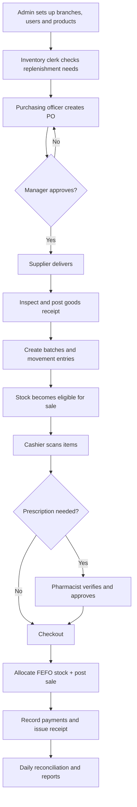
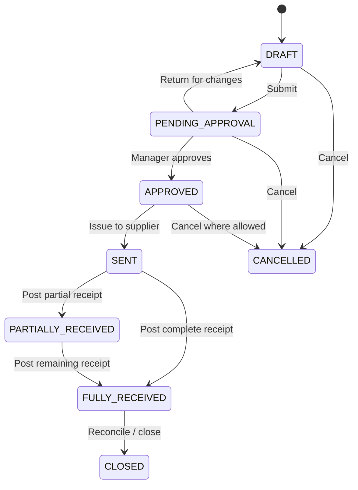
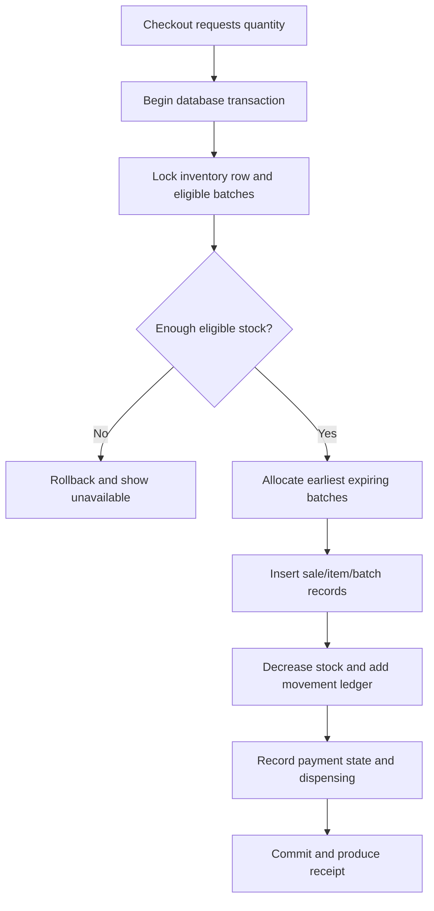
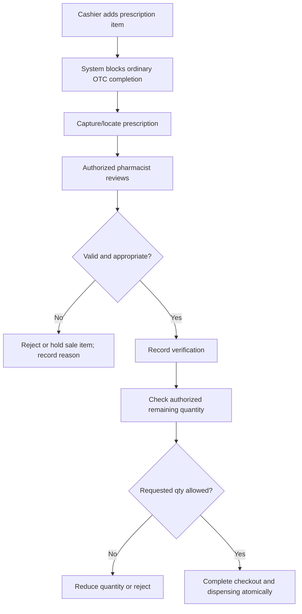
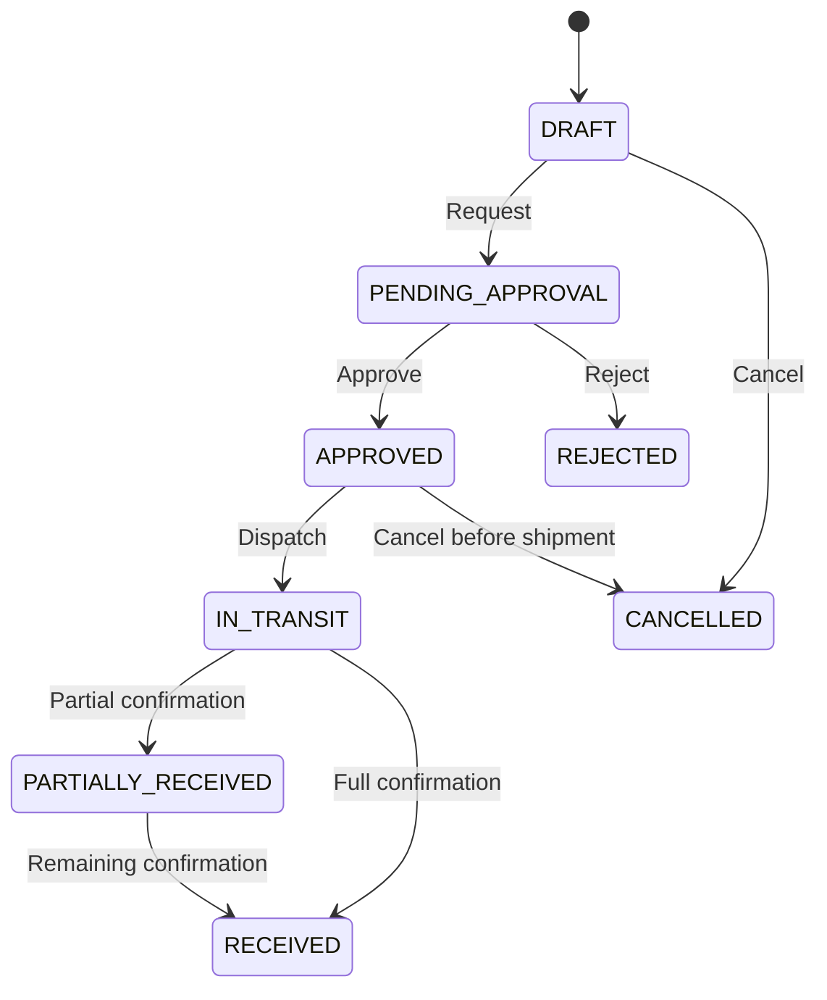

# Pharmacy Inventory & Point of Sale (POS) System

## Complete User Workflow & Business Process Specification

**Version:** 1.0  
**Database:** MySQL 8.0.16+  
**Primary/foreign key format:** Application-generated UUID (`CHAR(36)` with `ascii_bin` collation)  
**Database baseline:** `pharmacy_pos_schema_uuid.sql` (44 tables, 2 views)  
**Audience:** Pharmacy owners, administrators, pharmacists, cashiers, inventory clerks, purchasing staff, accountants, auditors, developers, and QA testers.

> **Scope:** This describes an end-to-end multi-branch pharmacy inventory and POS application. It defines workflows, role responsibilities, validation, data changes, status changes, exceptions, and acceptance criteria. It is a functional specification, not a substitute for professional pharmacy judgment or current local legal/regulatory guidance. Some recommended controls require additional database tables or columns; these are clearly identified in §24.

---

## Table of Contents

1. [Objectives and operating principles](#1-objectives-and-operating-principles)
2. [Roles and access matrix](#2-roles-and-access-matrix)
3. [System-wide lifecycle](#3-system-wide-lifecycle)
4. [WF-01: Initial system and branch setup](#4-wf-01-initial-system-and-branch-setup)
5. [WF-02: Authentication and user administration](#5-wf-02-authentication-and-user-administration)
6. [WF-03: Medicine/product setup](#6-wf-03-medicineproduct-setup)
7. [WF-04: Inventory monitoring and replenishment](#7-wf-04-inventory-monitoring-and-replenishment)
8. [WF-05: Supplier and purchase-order processing](#8-wf-05-supplier-and-purchase-order-processing)
9. [WF-06: Goods receipt and batch creation](#9-wf-06-goods-receipt-and-batch-creation)
10. [WF-07: Inventory availability and FEFO allocation](#10-wf-07-inventory-availability-and-fefo-allocation)
11. [WF-08: Open cash register and start shift](#11-wf-08-open-cash-register-and-start-shift)
12. [WF-09: OTC point-of-sale checkout](#12-wf-09-otc-point-of-sale-checkout)
13. [WF-10: Prescription verification and dispensing](#13-wf-10-prescription-verification-and-dispensing)
14. [WF-11: Split payments and payment failures](#14-wf-11-split-payments-and-payment-failures)
15. [WF-12: Returns and refunds](#15-wf-12-returns-and-refunds)
16. [WF-13: Physical count and stock adjustments](#16-wf-13-physical-count-and-stock-adjustments)
17. [WF-14: Expiry, damage, quarantine, and recalls](#17-wf-14-expiry-damage-quarantine-and-recalls)
18. [WF-15: Supplier purchase returns](#18-wf-15-supplier-purchase-returns)
19. [WF-16: Interbranch stock transfers](#19-wf-16-interbranch-stock-transfers)
20. [WF-17: Close shift and reconcile cash](#20-wf-17-close-shift-and-reconcile-cash)
21. [WF-18: Reports, audit, and record retention](#21-wf-18-reports-audit-and-record-retention)
22. [Cross-module scenarios and edge cases](#22-cross-module-scenarios-and-edge-cases)
23. [Business invariants and transaction boundaries](#23-business-invariants-and-transaction-boundaries)
24. [Database mapping and recommended schema extensions](#24-database-mapping-and-recommended-schema-extensions)
25. [Acceptance tests / definition of done](#25-acceptance-tests--definition-of-done)
26. [Suggested implementation milestones](#26-suggested-implementation-milestones)

---

## 1. Objectives and operating principles

### 1.1 Business goals

- Maintain accurate stock **per branch, product, and physical batch**.
- Sell medicines with a valid record of **what was dispensed, by whom, at what price, from which batches, and when**.
- Prevent sales of unavailable, expired, quarantined, or recalled stock.
- Trace stock from supplier delivery to sale, transfer, return, or disposal.
- Support pharmacist-controlled prescription review and partial dispensing where allowed.
- Support cashiers and split payment methods without losing financial traceability.
- Provide inventory valuation, sales, purchasing, expiry, reconciliation, and audit reports.
- Restrict sensitive actions with role permissions and approvals.

### 1.2 Key design rules

1. **UUID everywhere:** IDs are generated by the application, including child records. Never assume auto-incrementing identifiers.
2. **Base unit inventory:** Stock quantities are maintained in the product's base unit. One box can represent many tablets; conversions are captured in `product_units`.
3. **Per-batch stock:** Physical stock belongs to an `inventory_batches` record with a lot/batch number, received date, cost, and expiry where applicable.
4. **FEFO:** Prefer the **First Expired, First Out** eligible batches; never bypass eligibility restrictions to satisfy an order.
5. **Append-only movement ledger:** Every stock change creates an `inventory_movements` record. Corrections are compensating transactions, not erased history.
6. **Atomicity:** Stock, sales, receipt, transfer, and dispensing changes must be coordinated in database transactions with appropriate locks.
7. **Historical snapshots:** A receipt retains the name, quantity, price, discount, tax, and batch/cost allocations used at sale time.
8. **No silent deletion:** Financial, dispensing, and stock history is voided/reversed through authorized workflows, not deleted.
9. **Privacy by design:** Restrict patient and prescription access; minimize collected customer data; protect prescription attachments.
10. **Policy-driven taxes and discounts:** Applicable rules must be configurable and verified for the relevant jurisdiction.

### 1.3 High-level journey



---

## 2. Roles and access matrix

| Capability | Admin/Owner | Pharmacist | Cashier | Inventory Clerk | Purchasing Officer | Accountant | Auditor |
|---|---|---|---|---|---|---|---|
| Manage users/roles/branches | ✓ | — | — | — | — | — | Read-only |
| Create/edit product catalog | ✓ | Review | — | ✓ if assigned | — | — | Read-only |
| View product/eligible stock | ✓ | ✓ | ✓ | ✓ | ✓ | ✓ | ✓ |
| Create purchase order | ✓ | — | — | Request | ✓ | — | Read-only |
| Approve purchase order | ✓ | — | — | — | Only if delegated | — | Read-only |
| Receive/inspect stock | ✓ | Clinical review | — | ✓ | ✓ if assigned | — | Read-only |
| Approve inventory adjustment | ✓ | If delegated | — | No self-approval | — | — | Read-only |
| Verify prescription | Only if licensed/authorized | ✓ | ✗ | ✗ | ✗ | ✗ | Read-only, restricted |
| Process OTC sale | ✓ | ✓ if assigned | ✓ | — | — | — | Read-only |
| Dispense Rx medicine | Only if licensed/authorized | ✓ | Cannot self-approve | — | — | — | Read-only, restricted |
| Approve return/refund | ✓ | If delegated | Request only | — | — | — | Read-only |
| Open/close assigned register | ✓ | If assigned | ✓ | — | — | Reconcile | Read-only |
| View financial reports | ✓ | Limited | Own shift | Limited | Purchasing | ✓ | ✓ |

**Rules:** A role is an authorization boundary, not proof of a professional license. A user with the `pharmacist` role must also satisfy any actual professional/organizational eligibility requirements. The system's existing `users.branch_id` supports one default branch; cross-branch assignments require additional modeling or explicit privileged access.

---

## 3. System-wide lifecycle

### 3.1 Typical daily timeline

| Time/phase | Actor | Action | Result |
|---|---|---|---|
| Before opening | Admin / Pharmacist | Review expiry, quarantine, recalls, and alerts | Unsellable stock blocked |
| Start of shift | Cashier | Sign in, open register, count opening cash | Active register session |
| Throughout day | Cashier / Pharmacist | Search, scan, verify Rx, sell, and receive payment | Sale and stock movement records |
| Throughout day | Inventory / Purchasing | Receive shipments and post approved adjustments | Updated batch stocks |
| As needed | Manager | Approve PO, transfer, adjustment, refund | Authorized state transition |
| End of shift | Cashier | Count cash and close register | Reconciliation record |
| End of day | Owner / Accountant | Review sales, payments, exceptions, stock, and audit logs | Daily operating picture |

### 3.2 Mandatory status handling

- Users and products are deactivated, not destructively removed from active records.
- Draft transactions can be edited by authorized users; **posted/completed** transactions are not silently rewritten.
- Changes to stock happen at a well-defined **posting moment**, not merely when a draft is saved.
- An approval is bound to a specific version of a request. If a requester materially edits it, approval must be re-evaluated.
- Each action records the actor, branch, timestamp, linked records, and reason where appropriate.

---

## 4. WF-01: Initial system and branch setup

**Actor:** Super Admin / Owner  
**Trigger:** New system installation or new branch launch  
**Preconditions:** Database installed and secured; initial administrator provisioned out of band.

**Steps**

1. Create each branch (`branches`): name, unique code, contact details, address, and active status.
2. Create roles (`roles`) and permissions (`permissions`), then associate them using `role_permissions`.
3. Create employee accounts (`users`) and assign roles through `user_roles`.
4. Associate each user with the appropriate default branch.
5. Configure cash registers (`cash_registers`) per branch.
6. Add categories, manufacturers, units, medicine/product records, and barcodes.
7. Enter approved tax, discount, receipt, authorization, and business policies in configuration (requires extension if persisted dynamically).
8. Test permissions with a cashier, pharmacist, inventory clerk, purchasing officer, and manager.
9. Validate receipt numbering, time zone, scanner/printer behavior, and backup/restore procedures before enabling live transactions.

**Result:** A branch with access-controlled users, at least one cash register, and a sellable product catalog. Product creation **does not** imply stock exists.

**Exceptions:** Duplicate branch code, duplicate email, unauthorized role assignment, absent cashier register, invalid base unit. Block launch until resolved.

---

## 5. WF-02: Authentication and user administration

**Actors:** All staff; Admin for account management.

### 5.1 Login

1. Staff member enters identity and credentials.
2. Backend verifies password, account activity, and any required authentication factors.
3. Backend fetches roles and permissions; determines accessible branch(es).
4. Login event is recorded; staff sees only authorized navigation and data.
5. Expired/invalid sessions are rejected; authentication failures do not expose sensitive user information.

### 5.2 Provision, suspend, and change access

1. Admin creates a user with application-generated UUID.
2. Admin assigns role(s) and branch.
3. On duty change, admin updates roles/branch, records reason, and revokes existing sessions where necessary.
4. On departure, account is **deactivated** (`is_active = false`), not deleted.
5. Historical sales, adjustments, approvals, and logs remain linked to the original user.

**Data:** `users`, `roles`, `permissions`, `user_roles`, `role_permissions`, `branches`, `audit_logs`.

**Security requirements:** Server-side authorization, least privilege, password hashing, protected prescription files, per-branch data scoping, and protection against credential abuse.

---

## 6. WF-03: Medicine/product setup

**Actors:** Admin, Inventory Clerk; Pharmacist reviews drug classification.

### 6.1 Add a medicine

1. Open **Products → New Product**.
2. Enter SKU, generic and brand name, strength, dosage form, category, manufacturer, product display name, and optional description.
3. Set prescription classification and the requires-prescription flag based on approved drug information.
4. Set reorder threshold in **base units**.
5. Select one base unit (e.g., tablet) and define other purchase/sale units with conversion factors (e.g., strip = 10 tablets, box = 100 tablets).
6. Associate barcodes with the appropriate product packaging unit.
7. Validate duplicate SKU and barcode; check that conversions are positive and one—and only one—base unit is defined.
8. Save the product as active or inactive; record the actor and changes.
9. If products already have stock, restrict edits to conversion factors or require a controlled migration/reconciliation.

### 6.2 Example

| Property | Value |
|---|---|
| Product | Paracetamol 500 mg tablets |
| SKU | PARA-500-001 |
| Base unit | Tablet |
| Strip conversion | 1 strip = 10 tablets |
| Box conversion | 1 box = 100 tablets |
| Reorder level | 200 tablets |
| Quantity at product creation | 0 |

**Related data:** `product_categories`, `manufacturers`, `products`, `units`, `product_units`, `product_barcodes`, `audit_logs`.

**Exceptions:** Duplicate SKU/barcode; absent base unit; incompatible conversions; inactive manufacturer/category; conversion change after purchase history; incorrect Rx/controlled classification.

---

## 7. WF-04: Inventory monitoring and replenishment

**Actors:** Inventory Clerk, Purchasing Officer, Manager.

1. Open **Inventory → Stock Overview** for the selected branch.
2. System reads `inventories` with product/batch details and filters out disallowed stock for sale calculations.
3. Flag products with sellable stock below reorder level and batches approaching expiry.
4. Clerk physically checks shelf, backroom, pending deliveries, and any isolated stock.
5. Create purchasing request/PO using required quantity and supplier availability (a formal requisition table is an optional extension).
6. Purchasing staff reviews suggested quantity, supplier, unit cost, lead time, and expected delivery.
7. Manager approves purchase commitment where required.
8. The alert remains until inventory is sufficiently replenished or an authorized override is recorded.

**Important:** `inventories.quantity_on_hand` is the **aggregate quantity recorded**, not necessarily all legally and physically sellable stock. Evaluate eligible batches (status, expiration, recall, quarantine), reservations, and current policy before promising stock.

**Rule:** Do not create stock from a purchase order alone. Stock increases only after an accepted goods receipt has been posted.

---

## 8. WF-05: Supplier and purchase-order processing

**Actors:** Purchasing Officer, Manager, Supplier (external).

### 8.1 Supplier management

1. Add/update supplier name, contact information, tax identification where applicable, and payment terms.
2. Deactivate suppliers no longer approved for purchasing; retain historical PO links.

### 8.2 Purchase order lifecycle



1. Select branch and active supplier.
2. Create PO header (`purchase_orders`) and lines (`purchase_order_items`).
3. For each line, choose product, **purchase unit**, ordered quantity, price/cost, discounts, and taxes.
4. System calculates and snapshots line and PO totals; validates positive quantities.
5. Save `DRAFT` → submit `PENDING_APPROVAL`.
6. Manager checks supplier, price, quantities, authority limits, and need. Approve or return for changes.
7. On approval, set `APPROVED`; issue to supplier (`SENT`).
8. Supplier can deliver in multiple consignments; the PO is not complete until all required quantities are received or closed under policy.
9. Receiving updates **accepted** quantities and PO status, not merely supplier-stated quantity.

**Data:** `suppliers`, `purchase_orders`, `purchase_order_items`, `audit_logs`.

**Exceptions:** Order exceeds budget/approval limits; missing supplier information; duplicate PO number; over-delivery; partially fulfilled or canceled lines. Changes after `SENT` should be controlled and audited.

---

## 9. WF-06: Goods receipt and batch creation

**Actors:** Inventory Clerk; Pharmacist for product suitability questions; Manager for discrepancies.

**Trigger:** Supplier delivers items for a valid PO.  
**Inventory effect:** **Only posting an accepted receipt** can increase stock.

### 9.1 Receiving steps

1. Find the appropriate `SENT` or `PARTIALLY_RECEIVED` PO.
2. Create `goods_receipts` as `DRAFT`; enter receipt number, supplier invoice number, date/time, receiver, and branch.
3. Inspect each delivered product, its packaging, identity, quantity, storage/cold-chain evidence if applicable, batch number, manufacturing date, expiration date, and unit cost.
4. Record line-level `quantity_received`, `quantity_accepted`, and `quantity_rejected` (`goods_receipt_items`). Split lines by manufacturer batch if needed.
5. For each accepted batch, identify the branch/product inventory and create or appropriately associate an `inventory_batches` record.
6. Convert accepted purchase-unit quantity into base units: `accepted_purchase_quantity × conversion_factor`.
7. Show a review screen with batch quantities, expiry, accepted/rejected totals, costs, and any discrepancy reasons.
8. At **Post Receipt**, begin a DB transaction; lock affected PO and inventory rows.
9. Create/update batch records, increase `inventories.quantity_on_hand`, and append `inventory_movements` with `PURCHASE_RECEIVED`.
10. Update PO line `quantity_received`; change receipt status to `POSTED` and PO to `PARTIALLY_RECEIVED` or `FULLY_RECEIVED`.
11. Commit once. If any step fails, roll back all changes.
12. Generate discrepancy or supplier-return workflow for rejected stock; rejected goods never become sellable stock.

### 9.2 Sample calculation

| Item | Value |
|---|---:|
| Ordered | 10 boxes |
| Units per box | 100 tablets |
| Delivered | 10 boxes |
| Accepted | 9 boxes |
| Rejected | 1 box |
| Stock received | 900 tablets |
| Rejected (not stocked) | 100 tablets |

Two accepted physical batches would create separate receipt lines or associated batch records, each with its own expiration metadata.

### 9.3 Idempotency and disputes

- If a client retries **Post Receipt**, it must not create stock twice. A receipt with `POSTED` status must be rejected as already posted; lock it during posting.
- Reopening a posted receipt to edit quantities is prohibited; use a compensating workflow.
- If a supplier invoice differs from the PO, record the discrepancy and obtain authorization before posting.

**Data:** `purchase_orders`, `purchase_order_items`, `goods_receipts`, `goods_receipt_items`, `inventories`, `inventory_batches`, `inventory_movements`, `audit_logs`.

---

## 10. WF-07: Inventory availability and FEFO allocation

**Actors:** POS checkout service; Pharmacist/Cashier as requesters.

### 10.1 Batch eligibility

A batch is eligible only if:

- It belongs to the selling branch and product.
- It is in status `ACTIVE`.
- It has available quantity greater than zero.
- It is not expired under pharmacy policy (evaluate expiration at **checkout**, not only via a nightly job).
- It is not recalled/quarantined and is otherwise approved for dispensing.
- It has enough unreserved stock after reservations and competing checkouts are considered.

**Ordering:** Earliest eligible expiration first; tie-break by receiving date, then a stable ID. Null expiration dates require an explicit product-type-specific policy; do not let null dates silently outrank expiring medicines.

### 10.2 Allocation example

Customer requests **250 tablets**:

| Batch | Expiry | Available | Allocation |
|---|---|---:|---:|
| B-002 | 2027-01-31 | 200 | 200 |
| B-001 | 2027-03-31 | 100 | 50 |
| B-003 | 2027-07-31 | 150 | 0 |

Result: two `sale_item_batches` rows and two stock movement rows; sold quantity = 200 + 50 = 250.

### 10.3 Concurrency safety



**Rule:** Lock rows in a consistent order across sales, returns, and transfers to reduce deadlocks; retry safe transient deadlocks with the same idempotency key. Never allow negative stock as a shortcut.

---

## 11. WF-08: Open cash register and start shift

**Actors:** Cashier; Manager for override.

1. Cashier signs in and selects their authorized branch/register.
2. System checks `cash_registers.is_active` and whether another session is open for that register.
3. Cashier physically counts float and enters opening cash.
4. Backend creates `cash_register_sessions` (`OPEN`) with cashier, register, opening amount, and opening timestamp.
5. Optionally record a corresponding `cash_transactions` `OPENING_CASH` event; **avoid double counting** the same float when reconciling.
6. Cashier now accesses the POS terminal for that session.
7. Switches of cashier/register must be explicitly controlled and logged.

**No open register:** Sale completion is blocked if your branch policy requires a cash session.

**Concurrency:** Existing schema has a normal status index but does not inherently enforce one open session per register. Enforce this with an atomic lock or a schema-level mechanism; do not rely on a UI check alone.

**Data:** `cash_registers`, `cash_register_sessions`, `cash_transactions`, `users`.

---

## 12. WF-09: OTC point-of-sale checkout

**Actor:** Cashier.  
**Preconditions:** Authenticated, authorized, active branch, open register, available eligible inventory.

### 12.1 Build cart

1. Search by name/SKU or scan barcode.
2. Resolve `product_barcodes → product_units → products`.
3. Display product identity, packaging, selected selling unit, effective price, stock availability, and Rx warning.
4. Set quantity; calculate base-unit requirement using the unit conversion snapshot.
5. Validate sellability, pricing, and available eligible stock. Show warnings; **do not reserve stock merely because it is in a cart** unless reservations are explicitly implemented.
6. Add item to cart; allow permitted changes/removals before checkout.
7. Apply authorized discounts and applicable tax/discount rules, with the relevant eligibility evidence when required.
8. Display subtotal, discounts, applicable tax, total, and due amount.

### 12.2 Complete checkout

1. Cashier presses **Checkout**.
2. Backend revalidates permissions, product status, price, quantity, prescription flags, cash register status, and current eligibility (cart values may be stale).
3. If an Rx item exists, require an approved pharmacist verification linked to the applicable prescription (see WF-10).
4. Lock the relevant inventory and batch records and execute FEFO allocation.
5. Create one `sales` header and one or more `sale_items` with product name, unit, cost/price, tax, and discount snapshots.
6. Create `sale_item_batches` for each consumed physical batch.
7. Decrease `inventory_batches.quantity_available` and `inventories.quantity_on_hand`; append `inventory_movements` of type `SALE`.
8. Confirm and record payment(s) (`sale_payments`) and cash ledger entries where appropriate.
9. Persist dispensing records for Rx items, if any; finalize sale as `COMPLETED` only when required conditions are satisfied.
10. Commit atomically; generate or print the receipt using stored transaction snapshots.
11. If any critical operation fails, roll back stock/sale changes. Handle external payment authorization/capture separately, as described in WF-11.

### 12.3 Example receipt calculation

| Line | Quantity | Unit price | Line amount |
|---|---:|---:|---:|
| Paracetamol 500 mg | 2 strips | ₱30.00 | ₱60.00 |
| Vitamin C | 1 bottle | ₱120.00 | ₱120.00 |
| **Subtotal** | | | **₱180.00** |

Discounts, tax treatment, and net payable are derived according to verified current rules—not assumed by the example.

### 12.4 Failure cases

- **Barcode unknown:** Prompt for alternate search; do not guess product.
- **Product inactive:** Reject sale.
- **Expired/blocked batch:** Skip it; if insufficient valid stock remains, reject sale.
- **Insufficient stock:** Show fulfillable quantity or revise cart; do not create negative stock.
- **Expired price/discount authorization:** Recompute and request reapproval.
- **Duplicate checkout retry:** Reuse `sales.idempotency_key` and return existing outcome rather than charging/deducting twice.
- **Printer failure after commit:** Reprint receipt; **do not rerun the sale**.

**Data:** `sales`, `sale_items`, `sale_item_batches`, `sale_payments`, `cash_transactions`, `inventory_batches`, `inventories`, `inventory_movements`, `audit_logs`.

---

## 13. WF-10: Prescription verification and dispensing

**Actors:** Cashier initiates; authorized Pharmacist verifies/dispenses.  
**Preconditions:** Medicine requires prescription; applicable prescription presented and reviewed.

### 13.1 Verification flow



### 13.2 Steps

1. Identify patient/customer as required and capture minimum necessary information.
2. Record prescriber identity and license information, prescription date, expiry/validity if applicable, and secure attachment reference where applicable (`prescriptions`, `prescribing_physicians`).
3. Record prescribed products, authorized quantity, dosage instructions, frequency, and duration (`prescription_items`).
4. Pharmacist reviews authenticity, patient context, medicine, dose, expiry/validity, and any special controls required by law/policy.
5. If unsuitable, mark `REJECTED` (or hold for further review) and prevent the affected item from being dispensed.
6. If accepted, store `verified_by`, `verified_at`, and verification state.
7. At checkout, lock prescription item row(s), confirm requested quantity does not exceed authorized remaining quantity, then post corresponding `dispensings` and `dispensing_items`.
8. Increase `prescription_items.total_dispensed_quantity` by actual dispensing quantity within the transaction.
9. If all quantities have been dispensed, mark the prescription `FULLY_DISPENSED`; otherwise `PARTIALLY_DISPENSED` where partial fills are allowed.
10. Link the sale and prescription with `sale_prescriptions`, preserving pharmacist attribution.

**Remaining authorized quantity:** `prescribed_quantity − total_dispensed_quantity` (subject to applicable rules on refills, quantity, dates, and controlled substances).

**Important:** The schema tracks linked dispenses and aggregate quantities; clinical/legal verification is a professional workflow. A role label alone must not automatically authorize clinically restricted actions. Controlled-drug registers, patient identity verification, and specialized recordkeeping may require extensions.

**Data:** `prescribing_physicians`, `prescriptions`, `prescription_items`, `sale_prescriptions`, `dispensings`, `dispensing_items`, `sales`.

---

## 14. WF-11: Split payments and payment failures

**Actors:** Cashier, payment service/provider, Accountant.

### 14.1 Cash payment

1. Display final payable amount.
2. Enter cash tendered, calculate change.
3. Validate tendered amount is at least payable amount.
4. Record a `sale_payments` cash row; record cash flow for the register.
5. Complete sale and provide receipt.

### 14.2 Split tender

For a payable total of **₱1,000**:

| Payment | Amount |
|---|---:|
| Cash | ₱500 |
| E-wallet | ₱300 |
| Card | ₱200 |
| **Total successfully settled** | **₱1,000** |

1. Select first payment type and amount.
2. For electronic methods, initiate provider payment and receive a verified result/reference; persist pending/paid/failed state as appropriate.
3. Add subsequent payments until successfully paid amounts cover amount due.
4. Do not mark a sale `COMPLETED` while mandatory payments are unconfirmed.
5. Distinguish **cash received** from **net sale value** (change is not revenue).
6. Generate payment reconciliation and exception reports.

### 14.3 Failed/ambiguous provider response

- A failed card/e-wallet charge must not be counted as paid.
- If a provider charge succeeds but the backend crashes, use a provider idempotency/reference lookup and reconciliation; do not blindly recharge.
- Do not hold a database row lock during long external provider network calls. Use staged payment state and carefully finalize stock/sale at the correct business point.
- Prevent multiple refunds from exceeding the eligible paid amount.

**Schema note:** `sale_payments` supports multiple methods, but robust provider operations typically need additional payment-intent, attempts, provider-event, settlement, and idempotency tables.

---

## 15. WF-12: Returns and refunds

**Actors:** Cashier initiates; Manager authorizes; Pharmacist/authorized staff evaluates medicine disposition.

1. Find completed original sale by invoice, date, or customer.
2. Select original `sale_items` and quantities requested for return.
3. Check eligibility, original sold quantity, cumulative previously returned quantity, time limits, condition, and policy/legal restrictions.
4. Identify the **original dispensed batches** via `sale_item_batches` for traceability.
5. Record `sales_returns` as `DRAFT` with reason, linked sale/branch, and initiator.
6. Add `sales_return_items`, including quantity, price/refund snapshots, original batch, and disposition.
7. Manager authorizes or rejects per policy. Do **not** assume medicines can be resold simply because packaging looks intact.
8. Authorized pharmacist/employee determines `RESTOCK`, `QUARANTINE`, `DAMAGED`, or `DISPOSE`.
9. Process approved `refunds` using original or allowed refund method and provider reference.
10. At posting, create applicable stock movements only for the actual inventory disposition:
    - `RESTOCK`: return eligible stock to a compatible saleable batch after approval.
    - `QUARANTINE`: track physical receipt as non-sellable stock using explicit quarantine handling.
    - `DAMAGED` / `DISPOSE`: record physical disposition without making stock available for sale.
11. Update sale status `PARTIALLY_REFUNDED` or `REFUNDED` according to cumulative settled refunds and policy.
12. Audit reasons, inspections, approvals, financial outcomes, and stock consequences.

**Invariants:** Total returned per original sale line cannot exceed sold quantity; total refunded cannot exceed eligible refundable amount. Cross-check sale, return, and payment state with locks to prevent duplicate refunds.

**Schema note:** For accurate non-sellable quantities, model separate physical/on-hand, quarantined, and sellable balances or a lot-level location/disposition model (§24). The baseline schema only has one `quantity_available` per batch and a status, which is insufficient for every partial quarantine case.

---

## 16. WF-13: Physical count and stock adjustments

**Actors:** Inventory Clerk counts; Manager approves; Audit can inspect.

### 16.1 Cycle count / stocktake

1. Choose branch, product, and batch (prefer physically separated counting).
2. Clerk counts physical quantity and enters observed amount.
3. System snapshots current recorded quantity; determines variance.
4. Clerk provides reason (`DAMAGED`, missing stock, recording mistake, found units, etc.).
5. Create `inventory_adjustments` and `inventory_adjustment_items` as `DRAFT`.
6. Submit `PENDING_APPROVAL`; manager inspects evidence and counts.
7. Approve (`APPROVED`) or reject (`REJECTED`); require distinct approver when policy demands separation of duties.
8. At `POSTED`, lock batch/inventory, verify current balance still matches count snapshot or re-count, apply signed adjustment, and append `STOCK_ADJUSTMENT` movement.
9. Commit once; record audit trail and regenerate discrepancy/stock valuation report.

### 16.2 Example

- Recorded: **500 tablets**.
- Physically counted: **485 tablets**.
- Variance: **−15 tablets**.
- Approved action: batch balance 500 → 485 and movement `quantity_change = -15`.

**Exceptions:** A count conducted during ongoing sales may be stale; require a count freeze or recount/variance reconciliation. An upward adjustment may conflict with the baseline schema's `quantity_available <= quantity_received` check; see §24.

**Data:** `inventory_adjustments`, `inventory_adjustment_items`, `inventory_batches`, `inventories`, `inventory_movements`, `audit_logs`.

---

## 17. WF-14: Expiry, damage, quarantine, and recalls

**Actors:** Inventory Clerk, Pharmacist, Manager.

### 17.1 Expiration monitoring

1. Scheduled job and dashboard query scan `inventory_batches` for upcoming/past expiry.
2. Show expiry horizon by branch, product, batch number, available quantity, and expiry date.
3. Notify authorized staff and present FEFO/transfer/return options where permitted.
4. As a batch reaches its disqualifying expiry threshold, exclude it from POS allocation **immediately** even if its stored status has not yet been updated.
5. Authorize and document physical isolation, supplier return, or disposal.
6. Record actual physical write-off via an inventory movement (`EXPIRED`), with no unintended double deduction when status changes.

### 17.2 Damaged or quarantined goods

1. Record identity and affected quantities of damaged/suspected stock.
2. Physically isolate affected units; block their saleability.
3. Obtain pharmacist/manager decision, preserving reason/evidence.
4. For a full batch, set `QUARANTINED`; for partial batch, use additional disposition/location subrecords (required extension).
5. If disposed, post proper movement and preserve batch traceability.

### 17.3 Recall handling

1. Receive credible manufacturer/regulator recall notice.
2. Locate affected products and lots across all branches using `inventory_batches`.
3. Block/mark affected batches (`RECALLED`) before further dispensing.
4. Find historical affected `sale_item_batches` for traceability and any legally required follow-up.
5. Manage withdrawal, return, and reconciliation of recalled quantities.
6. Retain incident and evidence records; implement a dedicated recall case table for production (§24).

**Rule:** An expired/recalled batch must not become sellable simply because `quantity_available > 0`.

---

## 18. WF-15: Supplier purchase returns

**Actors:** Inventory Clerk, Purchasing Officer, Manager.

1. Identify received stock needing supplier return (wrong item, damage, discrepancy, recall, etc.).
2. Link supplier/branch/original goods receipt where known.
3. Create `purchase_returns` as `DRAFT`; add `purchase_return_items` with batch, quantity, unit cost, and value.
4. Verify quantity remains physically available and has not already been sold/transferred/returned.
5. Obtain approval (`PENDING_APPROVAL` → `APPROVED`).
6. Prepare and document return shipment.
7. Post return: lock original batch and inventory; deduct returned quantity; record `PURCHASE_RETURN` movement; set `POSTED`.
8. Reconcile supplier credit/replacement/payment externally or through additional accounts-payable tables.

**Exceptions:** Partial accepted/returned quantity, supplier refusal, stock unavailable, duplicate posting. Financial supplier credit notes and supplier payments are not modeled in the baseline 44 tables.

---

## 19. WF-16: Interbranch stock transfers

**Actors:** Requesting branch staff, Source Manager, Source Inventory Clerk, Receiving Branch Inventory Clerk.

### 19.1 Transfer lifecycle



### 19.2 Dispatch and receipt

1. Destination branch requests product, preferred batch/expiry, and quantity.
2. Create `stock_transfers` and `stock_transfer_items`, linking source/destination branches and source batch.
3. Manager reviews source stock, urgency, expiry, and branch need; approves or rejects.
4. Source clerk picks and verifies stock and documents shipped quantity.
5. At dispatch, transactionally lock source batch/inventory, decrement stock, and record `STOCK_TRANSFER_OUT`.
6. Mark transfer `IN_TRANSIT`; **do not** increase destination sellable inventory yet.
7. Destination clerk checks arriving physical quantity, batch label, product condition, and expiry.
8. Record received vs shipped quantities; note shortages/damage and create an incident if needed.
9. At receipt, create/associate destination batch preserving the manufacturer lot/expiry and documented cost basis; increase destination stock; record `STOCK_TRANSFER_IN`.
10. Set `PARTIALLY_RECEIVED` or `RECEIVED`; close discrepancies through documented resolution.

### 19.3 Integrity rules

- Source and destination must differ.
- Shipped ≤ requested; received ≤ shipped.
- Transferred batch identity, expiry, and valuation must be preserved across branches.
- Stock **in transit** is owned/traceable but not sellable in either branch.
- Receipt is idempotent; a repeated confirmation must not double-increase destination stock.
- Physical loss in transit requires accountable disposition and audit evidence.

**Data:** `stock_transfers`, `stock_transfer_items`, `inventory_batches`, `inventories`, `inventory_movements`, `audit_logs`.

**Schema limitation:** In-transit quantity and transfer shipment/receipt events warrant explicit tables or columns for robust partial deliveries (§24).

---

## 20. WF-17: Close shift and reconcile cash

**Actors:** Cashier, Manager, Accountant.

### 20.1 Closing sequence

1. Cashier requests **Close Register** for their open session.
2. System disallows or flags unresolved pending transactions/ambiguous payments.
3. Summarize opening float, actual cash tenders, cash refunds, cash-in/out, and expected drawer amount.
4. Cashier physically counts cash and records actual amount.
5. Compute expected cash and variance.
6. If variance exceeds policy threshold, require explanation and manager review.
7. Set session `CLOSED` or `RECONCILIATION_REQUIRED` as appropriate; store closing timestamp.
8. Lock the shift against further sales posting; produce shift report with payment-method reconciliation.

### 20.2 Formula

```text
expected_cash
  = opening_cash
  + actual_cash_collected_from_completed_sales
  - cash_change_given
  + cash_in
  - cash_refunds
  - cash_out

variance = actual_cash_counted - expected_cash
```

**Important:** Determine whether `CASH_SALE` entries represent *tender received* or *net amount kept* and apply that convention consistently; do not add `OPENING_CASH` cash transaction to `opening_cash` a second time. Electronic payments are reconciled separately from drawer cash.

**Data:** `cash_register_sessions`, `cash_transactions`, `sales`, `sale_payments`, `refunds`.

---

## 21. WF-18: Reports, audit, and record retention

**Actors:** Owner, Manager, Inventory Clerk, Accountant, Auditor.

### 21.1 Daily dashboard

- Daily sales: completed sales less eligible reversals/refunds, with gross and net amounts clearly distinguished.
- Payment breakdown: cash, card, GCash, Maya, bank transfer, and reconciliation discrepancies.
- Low stock: compare *sellable* stock with reorder threshold.
- Expiry: nearing expiry, expired, quarantined, and recalled batches.
- Purchase backlog: pending approval, sent, partially received, and overdue POs.
- Adjustment activity: requested, approved, rejected, and posted variances.

### 21.2 Standard reports

| Report | Main sources | Key dimensions |
|---|---|---|
| Sales by day/branch | `sales`, `sale_items` | Branch, cashier, date, product |
| Payment reconciliation | `sale_payments`, `cash_transactions`, `refunds` | Method, session, status |
| Inventory position | `inventories`, `inventory_batches` | Branch, product, batch |
| Stock movement ledger | `inventory_movements` | Batch, type, user, timestamp |
| Expiry/recall | `inventory_batches`, `sale_item_batches` | Lot, expiry, affected sales |
| Purchasing | `purchase_orders`, `goods_receipts` | Supplier, ordered/received |
| Cost of goods sold | `sale_item_batches` | Actual sold batch cost |
| Prescription dispensing | `prescriptions`, `dispensings` | Restricted views only |
| Cashier shift | `cash_register_sessions`, `cash_transactions` | Drawer, variance |
| Audit investigations | `audit_logs` | Actor, entity, reason, time |

### 21.3 Audit trail

1. Record high-value and sensitive actions with user, branch, event, affected entity, old/new values, timestamp, and reason.
2. Do not log raw passwords, card secrets, or unnecessary patient details.
3. Audit access is limited by role, with separate protection for prescription and patient records.
4. Preserve completed sales, payments, dispensing, stock movements, and adjustments according to applicable retention rules; avoid blanket deletion/soft-deletion of transactions.
5. Investigate discrepancies using linked document UUIDs and inventory movement reference fields.

---

## 22. Cross-module scenarios and edge cases

| Scenario | Required behavior | Affected modules |
|---|---|---|
| Two cashiers attempt last 5 tablets | Lock same eligible stock; only one can commit enough stock | POS + Inventory |
| Two different lots share same SKU | FEFO allocate the correct lots; preserve both allocations | Product + Inventory + Sales |
| Order 10 boxes, accept only 9 | Record 1 rejected; add only 900 base units if 100/box | PO + Receiving + Inventory |
| One PO delivered in two shipments | Each receipt posts once; PO remains partial until balanced | PO + Receiving |
| Same receipt accidentally submitted twice | Second post rejected or returns existing posted outcome | Receiving |
| Customer demands unavailable expired batch | Reject sale regardless of positive raw quantity | Inventory + POS |
| Rx requests more than authorized remainder | Pharmacist reviews; reduce or block transaction | Prescription + POS |
| Partial prescription fill | Record exact dispensed amount; update remaining authorization | Prescription + Dispensing |
| Card charged but application request times out | Reconcile provider reference; do not double charge or deduct stock | Payments + Sales |
| Printer offline after completed sale | Reprint from saved sale; never post sale twice | POS + Receipt |
| Customer returns opened medicine | Follow policy; generally hold/inspect and do not auto-restock | Returns + Inventory |
| Refunding one line twice | Limit total returned quantity and cumulative refunds | Returns + Refunds |
| Inventory adjustment counted before active sale | Detect stale count; require recount/revalidation | Stocktake + POS |
| Recalled lot sold at two branches | Block batch across branches and find all affected sales | Recall + Batch trace |
| In-transit shipment partially damaged | Record shipped/received discrepancy and quarantined loss | Transfer + Inventory |
| Cash drawer short after closing | Record variance, reason, and review; don't erase sales | Cash + Audit |
| User disabled while signed in | Revoke/expire session and recheck authorization | Authentication |
| Product unit factor changed after sales | Preserve historical conversion and require controlled migration | Catalog + Historical data |

---

## 23. Business invariants and transaction boundaries

### 23.1 Stock equations

```text
For an inventory record (branch + product):
  quantity_on_hand = sum(physically counted batch stock represented by that inventory)

At minimum:
  quantity_reserved >= 0
  quantity_reserved <= quantity_on_hand

Sellable quantity is NOT necessarily equal to quantity_on_hand:
  sellable_stock = eligible, non-expired, non-recalled,
                   non-quarantined, unreserved batch quantity

For each posted movement:
  quantity_after = quantity_before + quantity_change

For a sale item:
  sum(sale_item_batches.quantity) = sale_items.base_quantity
```

The baseline `inventories` and `inventory_batches` tables track quantities but do not have independent buckets for quarantined vs in-transit stock. Introduce the extra buckets/lot locations if your workflow requires partial quarantine or detailed physical reconciliations.

### 23.2 Money equations

```text
sale_total = subtotal - discount_amount + tax_amount
successful_payments - change_given = payable_total
net_revenue = eligible_completed_sales - eligible_refunds/void effects
COGS = sum(quantity taken from each batch × historical batch unit cost)
```

Keep tax exemptions, statutory discounts, rounding, and fee allocation consistent with an approved policy. Do not overwrite historical price or cost snapshots when the current product price changes.

### 23.3 Posting transactions

| Operation | Required atomic data changes |
|---|---|
| Post goods receipt | Receipt status + accepted batch/inventory increments + movement ledger + PO received quantities |
| Post sale | Sale/items + batch allocations + inventory decrements + ledger + applicable dispensing/payment state |
| Post stock adjustment | Approved adjustment status + batch/inventory correction + movement ledger |
| Post supplier return | Return status + affected batch/inventory decrement + movement ledger |
| Ship transfer | Transfer shipped quantities + source batch/inventory decrement + `STOCK_TRANSFER_OUT` |
| Receive transfer | Transfer received quantities + destination batch/inventory increment + `STOCK_TRANSFER_IN` |
| Eligible restock from return | Return disposition + batch/inventory increment + `SALE_RETURN` movement |

**Recommended request lifecycle:** validate → authorize → begin transaction → lock shared records → revalidate → write related rows with UUIDs → commit → issue receipt/notification. For third-party payments, place external calls in a separately reconciled state machine rather than a long-held MySQL transaction.

### 23.4 Technical safeguards

- Generate UUIDv7 in the application where supported; treat IDs as opaque strings, never sortable business sequence numbers.
- Use unique indexes for public document numbers, product SKU/barcodes, and checkout idempotency key.
- Enforce branch/product/batch consistency across linked records (additional composite FKs or transactional validation).
- Restrict `UPDATE`/`DELETE` on movement and audit tables for application users; correct with reversals.
- Guard critical `POST` endpoints against retries and duplicate business events.
- Use correct MySQL isolation/row-locking strategy; test concurrent checkout and transfer scenarios.
- Log errors safely without exposing patient data or payment credentials.

---

## 24. Database mapping and recommended schema extensions

### 24.1 Existing UUID database mapping (44 core tables)

| Module | Existing tables |
|---|---|
| Branches & access | `branches`, `users`, `roles`, `permissions`, `user_roles`, `role_permissions` |
| Catalog | `product_categories`, `manufacturers`, `products`, `units`, `product_units`, `product_barcodes` |
| Suppliers & buying | `suppliers`, `purchase_orders`, `purchase_order_items`, `goods_receipts`, `goods_receipt_items`, `purchase_returns`, `purchase_return_items` |
| Inventory | `inventories`, `inventory_batches`, `inventory_movements`, `inventory_adjustments`, `inventory_adjustment_items` |
| Customers & POS | `customers`, `sales`, `sale_items`, `sale_item_batches`, `sale_payments` |
| Prescriptions & dispensing | `prescribing_physicians`, `prescriptions`, `prescription_items`, `sale_prescriptions`, `dispensings`, `dispensing_items` |
| Returns & refunds | `sales_returns`, `sales_return_items`, `refunds` |
| Cash | `cash_registers`, `cash_register_sessions`, `cash_transactions` |
| Transfers | `stock_transfers`, `stock_transfer_items` |
| Audit | `audit_logs` |

**Views:** `v_inventory_stock`, `v_expiring_inventory`.  
**Identifiers:** Every existing table's `id` and foreign-key identifier uses UUID `CHAR(36)` in the supplied SQL. Junction tables use composite UUID foreign-key primary keys where applicable.

### 24.2 Recommended changes before production

The baseline SQL does **not** fully encode all workflow constraints. Plan these schema improvements:

1. **Prices and statutory discounts:** Add `product_prices` (branch-specific, unit-specific, effective dates), `tax_rules`, `discount_rules`, `sale_discounts`, and eligibility/approval evidence if required. Current baseline has historical *sale* price, but no full maintained pricing catalog.
2. **User branch assignments:** Add `user_branches` for staff working across multiple branches; keep explicit branch context on each transaction.
3. **Partial quarantine and stock locations:** Add `inventory_locations` / `batch_stock_balances` (sellable, quarantined, damaged, in transit, etc.), avoiding one-batch-one-status limitations.
4. **Batch quantity check:** The baseline `inventory_batches` check `quantity_available <= quantity_received` can reject legitimate **positive adjustments, restocks, or transferred arrivals** if the quantity received field isn't updated consistently. Redesign balances vs lifetime receipts instead of weakening integrity casually.
5. **Receipt idempotency:** Add unique posting-operation identifiers, source line identities, and posting/reversal references so retries and corrections are unambiguous.
6. **Cash register uniqueness:** Enforce one active/open register session in the database or a robust atomic locking mechanism; a regular index on status alone does not enforce uniqueness.
7. **Payment providers:** Add payment attempts/intents, webhook events, provider references, refund attempts, and settlement reconciliation.
8. **Recall management:** Add `recall_cases`, `recall_lots`, status/notifications, and recall resolution evidence to fully document product recalls.
9. **Supplier finance:** Add `supplier_invoices`, `supplier_payments`, `supplier_credits` if accounts payable is in scope.
10. **Transfer in-transit ledger:** Add transfer dispatch/receipt events and quantity-in-transit tracking to support partial shipments and damage.
11. **Inventory activity integrity:** Enforce batch/product/branch match and sale item/product unit consistency with composite keys/constraints or strict service-level checks.
12. **Professional dispensing controls:** Add verification/rejection reasons, controlled-substance-specific records where required, legal retention/access policies, and audit evidence without exposing unnecessary private details.
13. **Receipt compliance:** Add tax/invoice sequencing, receipt device/printer records, official-transaction metadata and immutable fiscal snapshots where required by local rules.
14. **Expiration policy:** Establish product-specific last-sellable-date policy rather than relying only on coarse cron-updated batch `status`.
15. **Stock reservation model:** If carts or online orders reserve stock, add reservation ownership, expiration, release, and consistent per-batch balances.

These are **recommended extensions**, not tables you can query from the baseline schema without first creating them.

---

## 25. Acceptance tests / definition of done

### 25.1 User and permission tests

- [ ] Admin can create, assign, and deactivate users.
- [ ] Cashier cannot alter batch balances or self-approve refunds/discount overrides.
- [ ] Non-pharmacist cannot approve a prescription that requires licensed review.
- [ ] Cross-branch staff cannot see or modify unauthorized branch records.

### 25.2 Catalog and procurement

- [ ] Duplicate SKU or barcode is rejected.
- [ ] Only valid positive unit conversion factors are saved.
- [ ] PO approval and state transitions are audited.
- [ ] Goods receipt supports split batches, accepted/rejected quantities, and partial PO fulfillment.
- [ ] Posting the same receipt twice does not duplicate stock.

### 25.3 Inventory and FEFO

- [ ] One carton/strip is converted correctly into base units.
- [ ] Multiple batches are allocated by earliest eligible expiry.
- [ ] Expired, recalled, quarantined, and depleted batches cannot be sold.
- [ ] Two concurrent checkouts cannot sell the same final units twice.
- [ ] Every stock change generates the correct immutable ledger entry.
- [ ] Posting a transfer changes source and destination stock at the correct shipment/receipt steps.

### 25.4 Sales, payments, Rx

- [ ] Historical receipts keep prices and product names even if master data changes.
- [ ] Checkout retry with the same idempotency key creates no duplicate sale.
- [ ] Split payments total correctly; failed provider charges are not treated as paid.
- [ ] Insufficient cash tender is rejected and change is calculated correctly.
- [ ] Rx items are blocked without required pharmacist verification.
- [ ] Partial dispensing reduces authorized remaining quantity correctly.
- [ ] Printer failure after commit allows reprint without another sale.

### 25.5 Returns, reconciliation, audit

- [ ] Returned quantity cannot exceed the original sold quantity across all returns.
- [ ] Refund cannot exceed eligible amount, including multiple partial refunds.
- [ ] Returned medicines do not automatically re-enter sellable inventory.
- [ ] Shift expected cash and actual cash reconciliation is correct.
- [ ] Audit logs link action, actor, branch, entity, and timestamp.
- [ ] Reversing a mistake preserves the original historical records.

---

## 26. Suggested implementation milestones

| Stage | Deliverables | Completion gate |
|---|---|---|
| 1. Foundation | UUID schema, authorization, branch scope, staff accounts | Role and branch access tests pass |
| 2. Catalog | Products, units, conversions, barcodes, classifications | Catalog validation and scanner tests pass |
| 3. Inventory engine | Batch balances, FEFO allocator, movement ledger, locking | Concurrent inventory tests pass |
| 4. Procurement | Suppliers, PO approval, receipts, partial deliveries | Duplicate receipt and batch tests pass |
| 5. POS | Cart, prices, payments, checkout, receipts | Atomic checkout and idempotency tests pass |
| 6. Pharmacy compliance | Prescription verification, dispensing, blocked stock | Pharmacist authorization and quantity checks pass |
| 7. Post-sale | Returns, refunds, adjustments, transfer handling | Restock/disposition and variance tests pass |
| 8. Operations | Registers, audit, reports, alert jobs | End-of-day reconciliation and recovery drills pass |
| 9. Hardening | Payment recovery, backups, schema extensions, monitoring | Security and load/UAT sign-off |

### Recommended implementation layering

```text
Frontend (React / TypeScript)
    ↓  role-aware interface; no trust in browser totals
REST API (Laravel 13)
    ↓  authentication, requests, policies, resource responses
Business Actions / Services
    ↓  Checkout, FEFO, PostReceipt, Dispense, Refund, Transfer
Database Transactions
    ↓  locking, constraints, immutable movement/audit ledger
MySQL (UUID-based, per-branch/per-batch)
```

### Final operational principle

> **Every completed medicine sale must be reconstructible:** which product and packaging unit was sold, what quantity was sold in base units, which lot(s) supplied it, who authorized dispensing where necessary, which payment(s) were accepted, what the customer paid, which cashier/register processed it, and how inventory changed. The same traceability applies in reverse for a refund, supplier return, adjustment, or transfer.

---

*End of workflow specification.*
